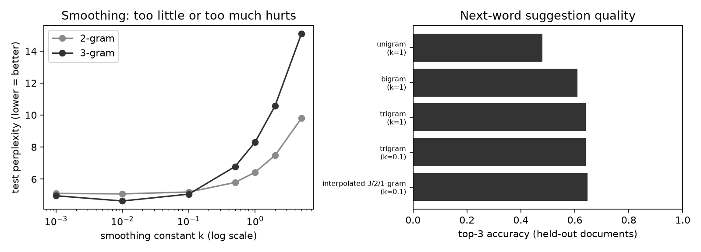

# Smart Keyboard — N-gram Prediction Lab

An interactive Streamlit application that suggests the next word using unigram, bigram, and trigram language models. Built for Lab 02 using a small synthetic English corpus. No API keys or external model downloads are required.

## Features

- Click a word suggestion to append it to your sentence.
- Compare hard back-off, interpolated, trigram, bigram, and unigram predictions.
- Adjust add-k smoothing and display three to six suggestions.
- Inspect the context used by the model and warnings for unknown words.
- Evaluate perplexity and top-3 accuracy on held-out documents.
- Browse the corpus, search sentences, and explore word frequencies.
- Download your text or evaluation results.

## Deploy on Streamlit Community Cloud

1. Sign in to [Streamlit Community Cloud](https://share.streamlit.io/) with GitHub.
2. Select **Create app**, then deploy an app from GitHub.
3. Use these settings:

   | Setting | Value |
   | --- | --- |
   | Repository | `mustapha005/streamLIT` |
   | Branch | `main` |
   | Main file path | `app.py` |
   | Python version (Advanced settings) | `3.12` |

4. Leave secrets empty; this app does not require any.
5. Click **Deploy**. Streamlit installs `requirements.txt` and starts the app.

The corpus is included in the repository and the models train in memory at startup. There is no separate training or data upload step. If GitHub repository access is requested, grant Streamlit access to this repository.

See the [official deployment guide](https://docs.streamlit.io/deploy/streamlit-community-cloud/deploy-your-app/deploy) and [dependency guide](https://docs.streamlit.io/deploy/streamlit-community-cloud/deploy-your-app/app-dependencies).

## Run locally

Use Python 3.12, the version used for local testing.

```bash
git clone https://github.com/mustapha005/streamLIT.git
cd streamLIT
python -m venv .venv
```

Activate the environment on Windows PowerShell:

```powershell
.\.venv\Scripts\Activate.ps1
```

Or on macOS/Linux:

```bash
source .venv/bin/activate
```

Install dependencies and launch:

```bash
python -m pip install -r requirements.txt
python -m streamlit run app.py
```

Open http://localhost:8501. On Windows, you can alternatively double-click **Start Smart Keyboard.cmd**. Keep the terminal open while using the app; press Ctrl+C to stop it.

## Using the app

Type a sentence and press Ctrl+Enter or leave the text field to refresh predictions. Click a suggestion to insert it. A period starts a fresh prediction context. Use the sidebar to choose the prediction method, smoothing constant, and number of suggestions.

The composer defaults to using only training documents. Turn off **Use training documents only** to train the composer on the complete corpus. Evaluation always uses its own fixed document split, regardless of this option.

## How the models work

An n-gram model estimates the next word from the preceding n-1 words. Add-k smoothing assigns probability to unseen continuations:

```text
P(word | context) = (count(context, word) + k) / (count(context) + k * vocabulary_size)
```

Hard back-off selects the highest-order model whose context was observed: trigram, then bigram, then unigram. Interpolation combines the three distributions with weights 0.6, 0.3, and 0.1. Unknown input words are mapped to `<unk>`.

## Evaluation

The fixed split assigns the first 80% of documents to training and the last 20% to testing: 960 training sentences and 240 test sentences. Top-3 accuracy measures whether the actual next token appears among the three suggestions. Perplexity measures how well a model predicts the held-out text; lower is better. End-of-sentence tokens are included.

Run the original evaluation from the repository root:

```bash
python -m src.evaluate
```

This writes metrics, failure examples, and a chart to `results/`. On the bundled corpus, hard back-off with k=0.1 achieved approximately **64.2% top-3 accuracy**. These results describe this synthetic teaching dataset, not general English typing performance.



## Project structure

```text
app.py                     Streamlit interface
requirements.txt           Pinned Python dependencies
.streamlit/config.toml     App theme
src/pipeline.py            N-gram models and data loading
src/evaluate.py            Held-out evaluation and plots
data/corpus.csv            Bundled synthetic corpus
data/make_data.py          Corpus generation script
results/                   Evaluation outputs
Start Smart Keyboard.cmd   Windows launcher
```

## Limitations

Predictions are limited to the small English vocabulary in the corpus. This is an educational statistical language model, not a large language model. Displayed suggestion probabilities use the full vocabulary, so they need not sum to 100%. User text is held in the current Streamlit session; download it if you want to keep it.
